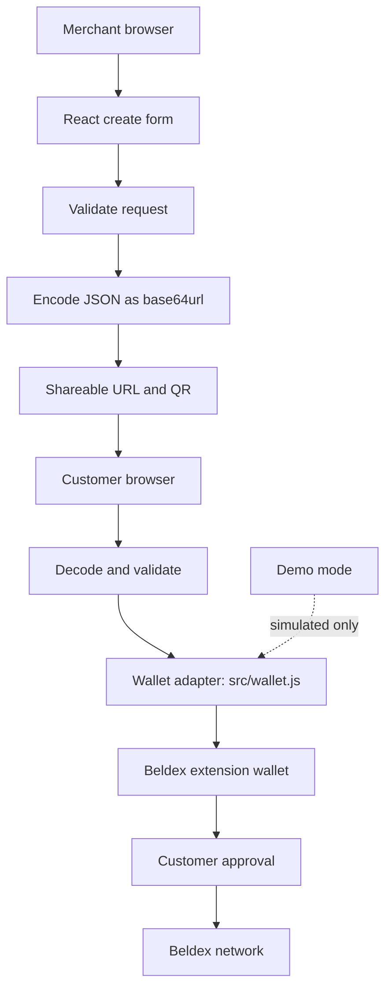

# BDXPAY

**Private payment links, built on Beldex.**

BDXPAY is a non-custodial, static-site prototype for shareable Beldex payment requests. Merchants enter a receiving address, amount, optional note and expiry. The request is encoded in the URL as base64url JSON and rendered as a QR code. No application backend, accounts, analytics, trackers or server-side payment-request storage are required.

> **Testnet prototype — do not use real funds.** Demo mode simulates the wallet and transaction locally. Live wallet connection and transaction submission are intentionally disabled until the official `@bdxi/web3js` extension and transaction APIs have been verified. The app must not be represented as production-ready.

## Features

- React + Vite static frontend, suitable for Vercel.
- Create payment links with recipient, positive amount, optional note and expiry.
- Base64url JSON in the `r` query parameter; QR generation and copy-link action.
- Customer payment-request view with connect/pay flow.
- Demo mode, pending/submitted/failed UI states, and simulated demo hash.
- Testnet default, network selector, responsive layout and light/dark theme.
- Client-side validation; React renders user values as text (not HTML).

## Beldex integration status

Wallet code is isolated in `src/wallet.js`. The SDK API names are not guessed. Clearly marked TODOs identify where to verify the official extension provider discovery, connect/account permissions, transaction creation, signing, broadcast, fees, amount units and network verification. Until those are verified, live mode fails safely. Demo hashes are not blockchain transaction IDs.

The address-format check is a conservative placeholder, not proof of address validity. A payment URL exposes its recipient, amount and note to anyone who obtains it; do not put secrets in notes.

## Architecture



## Local setup

Requirements: Node.js 18+ and npm.

```bash
git clone https://github.com/tothemoon244/bdxpay.git
cd bdxpay
npm install
npm run dev
```

Build and preview with `npm run build` and `npm run preview`. Open the Vite URL, create a request with a plausible-format Beldex address, and open the generated URL in another tab.

## Vercel deployment

Import this GitHub repository into Vercel. Choose Vite, set build command to `npm run build` and output directory to `dist`. The included `vercel.json` SPA rewrite preserves payment-link routing. No backend or environment variables are required for demo mode.

## Testnet testing

See [docs/TESTING.md](docs/TESTING.md). Testnet is the default request network, but a network label is not a substitute for wallet-side chain verification. Live transactions are not enabled.

## Security

- Never enter seed phrases or private keys into this app.
- No custody or transaction signing is implemented in demo mode.
- Demo transaction hashes are random local identifiers, not verifiable on-chain.
- URL data is visible to link recipients and may be retained by browser history or messaging services.
- Before live release, verify SDK APIs, chain identity, address validation, decimal precision, fees, balance checks, rejection handling, receipts, expiry semantics and perform an independent security review.
- See [SECURITY.md](SECURITY.md).

## Roadmap

| Milestone | Scope | Status |
|---|---|---|
| Prototype | Static UI, URL requests, QR and demo flow | Implemented |
| Testing | Verified SDK adapter and real testnet QA | Planned |
| Refine | Accessibility, robust validation and receipt UX | Planned |
| Mainnet | Security review and mainnet safeguards | Not started |

## Contributing

Issues and pull requests are welcome. Keep wallet logic in `src/wallet.js`, avoid analytics and server-side request storage, and include manual test steps. Never submit secrets. See [SECURITY.md](SECURITY.md) for responsible disclosure.

## License

MIT. See [LICENSE](LICENSE).
